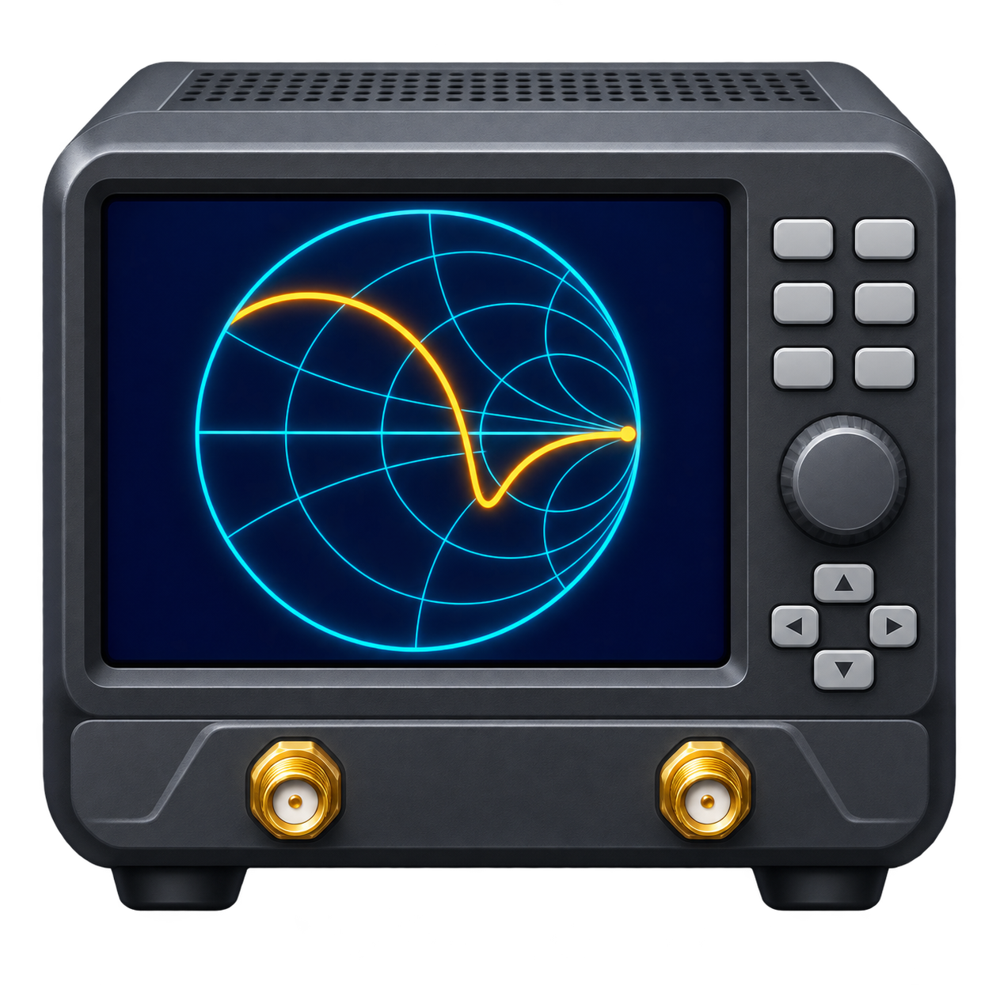

# Siglent SVA1032X



Python/PySide6 application by Ilia Kuznetcov for S11 acquisition, timed
measurement logging, and trace comparison with the Siglent SVA1032X.
Communication uses PyVISA and SCPI commands over a USB VISA connection.

## Features

- Connect to the instrument and select VNA mode.
- Trigger S11 acquisition manually or at a chosen interval.
- Capture SHORT/OPEN/LOAD software calibration and save/load calibration JSON.
- Store complex S11 and frequency data in SQLite with UTC timestamps,
  descriptions, and an automatic/manual flag.
- Compare saved traces using magnitude (dB), phase, real, imaginary, or Smith plots.
- Export selected measurements to CSV and delete selected database records.

## Dependencies

Python 3 and the following packages are required:

| Package | Purpose |
| --- | --- |
| PySide6 | Desktop interface |
| NumPy | Numerical arrays and complex data |
| Matplotlib | Plots and navigation toolbar |
| PyVISA | Instrument communication (`pyvisa`) |
| scikit-rf | Smith-chart plotting (`skrf`) |

`sys`, `json`, `threading`, `sqlite3`, `time`, `datetime`, and `pathlib` are
included with Python. Package dependencies are installed by pip.

A compatible VISA backend is also required for instrument communication.
With a vendor backend, install its VISA runtime, such as NI-VISA, separately.
The application calls `pyvisa.ResourceManager()` and uses the configured backend.
Installing PyVISA alone does not install a vendor VISA runtime.
See [PyVISA backend configuration](https://pyvisa.readthedocs.io/en/stable/introduction/configuring.html).

## Install and run

From the project root in PowerShell:

```powershell
py -m venv .venv
.venv\Scripts\Activate.ps1
python -m pip install -r requirements.txt
cd src
python siglent_app.py
```

## Instrument connection

Connect the SVA1032X through USB and list available VISA resources:

```powershell
python -c "import pyvisa; rm = pyvisa.ResourceManager(); print(rm.list_resources()); rm.close()"
```

Select the instrument's address in the **VISA resource** field and click **Connect**.
**Refresh Resources** lists detected resources after connecting the USB cable.
You can also enter a resource address manually, including a supported LAN VISA
address. This instrument uses VISA addresses rather than a COM-port selector.
No resource address needs to be changed in the source code.

**Disconnect** releases the instrument session, stops automatic acquisition, and
turns off software calibration. Load a matching JSON calibration or capture OSL
after reconnecting. Refresh and address editing are disabled while connected.
Discovery lists resources without sending measurement or calibration commands.
The instrument has no sweep-setting widgets in this application.

The sweep defaults in `SiglentVNA.__init__` are **100 kHz to 1 GHz**, **601 points**,
with a **linear** frequency axis. The VISA timeout is **20 seconds**.
Adjust these settings in the script when required. Keep the instrument setup,
calibration, and trace configuration appropriate for the measurement.

The application selects trace 1 as S11, selects Smith complex (real/imaginary)
format, turns off trace math/hold, requests ASCII transfer, and reads the documented
`CALCulate:DATA:FDATa?` response. Invalid or incomplete trace data are rejected.
Instrument sweep settings are read back for measurement and calibration checks.

## Calibration

The application supports ideal **50-ohm software one-port OSL calibration**.
It uses measured short/open/load traces to calculate directivity, source-match,
and reflection-tracking correction. See [CALIBRATION.md](CALIBRATION.md).

1. Connect the instrument and establish the desired cables and reference plane.
2. Click **New OSL**. Confirm clearing the instrument's calibration and disabling
   port extension. Automatic acquisition is stopped.
3. Attach each standard to the port 1 reference plane and click **SHORT**, **OPEN**,
   and **LOAD**, confirming each capture. The indicator becomes ready after all
   three distinct standards have been captured and calculated successfully.
4. Remove the last standard, attach the device under test, and click **Trigger**.
   Software-corrected values are plotted, stored, and exported.
5. Click **Save Cal JSON** to save the standards, frequency axis, instrument identity,
   and sweep settings. **Load Cal JSON** validates the file against the connected
   instrument and current sweep before preparing the instrument for software correction.

The ready indicator says **Software OSL ready — correction enabled**. Hover over it
to see the calibration identifier (SHA-256 fingerprint) and capture time. The
identifier distinguishes calibration profiles; it is not an error or accuracy score.

A matching instrument, frequency grid, point count, and IF bandwidth are required.
The instrument must report no native calibration and no port extension for every
software-calibrated acquisition. Incomplete, mismatched, or conflicting calibration
blocks storage and stops automatic acquisition. Keep cables, connectors, reference
plane, RF settings, and operating conditions consistent; these cannot all be
verified by a JSON file.

The standard model assumes ideal short (-1), open (+1), and matched load (0).
It does not model real calibration-kit parasitics. JSON files contain application
calibration data, not the instrument's native calibration coefficients, and are
not interchangeable with NanoVNA calibration JSON files.

**Disable Software Cal** turns off software correction for subsequent measurements.
Previously saved results are unchanged. It does not restore previously
cleared instrument calibration. Perform native calibration on the instrument if
needed. In this mode, the application records the instrument's returned trace;
it does not claim that native correction is active.

## Usage

1. Select the **VISA resource** and click **Connect**. The application configures the sweep, requests VNA mode,
   and disables continuous initiation.
2. Enter an optional description and click **Trigger**. The sweep is triggered,
   completion is awaited with `*OPC?`, and the trace is stored and plotted.
   In software OSL mode the completed calibration is applied first.
3. For automatic acquisition, set the interval in seconds and click **Start Auto**.
   Click **Stop Auto** to stop. Acquisition runs on the GUI thread, so a long
   sweep can delay interaction and the requested interval is not a guaranteed cadence.
4. Select rows, choose a plot type, and click **Plot Selected** to compare traces.
   Magnitude is displayed in dB; frequency plots use MHz. Smith plots use scikit-rf.
5. Use **Export Selected to CSV** for traces sharing the same frequency grid.
   Descriptions with commas, quotes, or newlines are escaped correctly in CSV.
   Export rejects records with different frequency grids or point counts.
6. **Delete Selected** removes database records immediately. Back up the database
   before deletion.

Manual acquisition clears the description after saving. During automatic
acquisition the description is retained. A manual trigger while the timer is
active is also marked automatic. Double-click a **Description** cell in the table to edit a recorded description,
then press Enter to save it to SQLite. Plot legends and CSV exports use the saved
description. IDs, timestamps, points, automatic/manual flags, measurement values,
and calibration records remain read-only. The ID column displays the numeric ID.
Automatic capture waits while a description editor is open.

## Measurement files

`vna_measurements.db` is created in the current working directory. Launching
from `src/` keeps this path predictable. The `measurements` table stores `id`,
`ts`, `start_hz`, `stop_hz`, `points`, `freqs_json`, `s11_json`, `note`, and `auto`.
Complex values are stored as `[real, imaginary]` pairs. New records also include
`raw_s11_json` (trace before software correction) and `calibration_json` (the complete
software calibration profile when used, otherwise NULL). Existing databases are
extended automatically; existing records and values are preserved. Historical
records have no newly inferred calibration state.

CSV contains `Frequency_Hz` followed by real/imaginary S11 columns for each
selected measurement. Column labels include record IDs, descriptions, and UTC
timestamps (with colons replaced by hyphens). Export together only records with
identical frequency grids and point counts.

## Windows executable

From the project root:

```powershell
.\build_release.ps1
```

The script uses `.venv`, installs dependencies and PyInstaller, and creates
`dist/Siglent_SVA1032X.exe`, `dist/Siglent_SVA1032X_v1.0.0_Windows.zip`, and
`dist/SHA256SUMS.txt`. If needed, allow the script for the current PowerShell
session with `Set-ExecutionPolicy -Scope Process -ExecutionPolicy Bypass`.

Extract the release ZIP to a writable directory before running the executable.
Python is not required for the executable; the compatible VISA runtime and
instrument drivers remain system requirements.

## Attribution

The application uses PySide6, NumPy, Matplotlib, PyVISA, and scikit-rf.
See [THIRD_PARTY_NOTICES.md](THIRD_PARTY_NOTICES.md) for project links.
